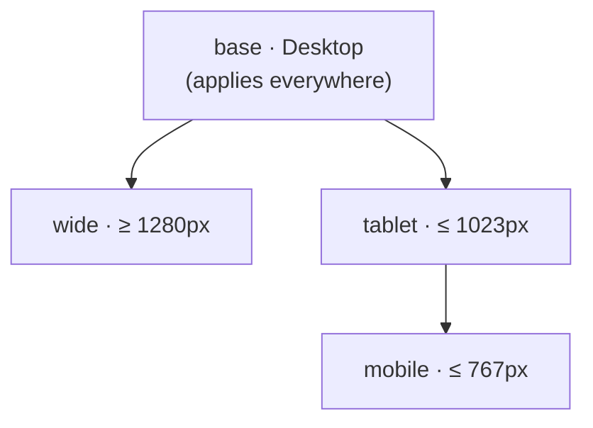

## Elements, not blocks

Most Puck setups expose **blocks**: a “Hero” with a title, a subtitle and two buttons, styled by a developer.
puck-kit exposes **elements** — Section, Box, Heading, Button… — that editors combine and style like in
Webflow. A hero is just:

```txt
Section
└── Container
    └── V Flex
        ├── Heading
        ├── Paragraph
        └── H Flex
            ├── Button
            └── Button
```

You can mix both approaches: keep the kit’s elements and add your own blocks
([custom blocks](/docs/guides/custom-blocks)).

## Slots are the element

Container elements are Puck **slots** rendered *as* the element (`<Content as="ul" />`), and every
component uses Puck’s **inline** mode. Result: no wrapper `<div>`s, in the editor or on the page.

```html
<!-- A List with two items, as rendered -->
<ul class="pk-List-1">
  <li class="pk-ListItem-1">…</li>
  <li class="pk-ListItem-2">…</li>
</ul>
```

That is why a Grid’s layout applies directly to the elements dropped inside it, and why the Flex child /
Grid child sections can style a child relative to its parent.

## The `styles` prop

Every element stores its styles as plain data:

```ts
type Styles = Record<string, StyleDecl | undefined>;
//                     ^ "base", "tablet", "mobile", "wide", "base:hover", "tablet:active"…
type StyleDecl = Partial<Record<StyleProp, string>>;
//                              ^ camelCase CSS property, e.g. "paddingTop", "gridTemplateColumns"
```

- Keys are **breakpoints** (`base`, `tablet`…) or **breakpoint + state** (`base:hover`).
- Values are CSS strings; bare numbers get `px` (except unitless properties like `opacity`, `zIndex`,
  `lineHeight`, `fontWeight`).
- Values may reference **tokens**: `var(--pk-color-primary)`.

The style panel only edits this object. The [compiler](/docs/styling/css-output) turns it into CSS.

## Breakpoints (desktop-first)

By default `base` is **Desktop** and applies everywhere; **Tablet** (≤ 1023px) then **Mobile** (≤ 767px)
override it going down, and **Wide** (≥ 1280px) overrides it going up. A value set on Desktop is
*inherited* on Tablet and Mobile until you change it there.



Breakpoints are configurable, and mobile-first is one option away. → [Breakpoints](/docs/styling/breakpoints)

## States

Pick a state in the style panel (Hover, Pressed, Keyboard focus, First child, Odd children…) and style as
usual. It’s stored as `<breakpoint>:<state>` and compiled to `.pk-<id>:hover { … }` inside the breakpoint’s media
query. → [States](/docs/styling/states)

## Tokens

Design tokens — colors, fonts and sizes — are stored in `root.props.tokens`, emitted as CSS variables
(`--pk-color-primary`) and offered as swatches and presets in every field. Renaming a token rewrites every
reference. → [Design tokens](/docs/styling/tokens)

## Server-safe rendering

Kit components have no hooks and no client code. Each one renders an `<ElementStyle>` that compiles its styles
during render; React 19 hoists and deduplicates the resulting `<style>` tags. Public pages therefore need
**zero client JavaScript** from the kit. → [CSS output](/docs/styling/css-output)

## Deterministic classes

An element’s class is derived from its Puck id: `pk-` + the id with unsafe characters replaced by `_`.
Same id, same class, on the server and the client — no hydration mismatches, no runtime CSS-in-JS.

<Callout type="info" title="Puck ids">
  Puck generates ids like `Heading-6f1c…` when an element is dropped and keeps them in the data. Duplicating an
  element gives the copy a new id, so styles never collide.
</Callout>
