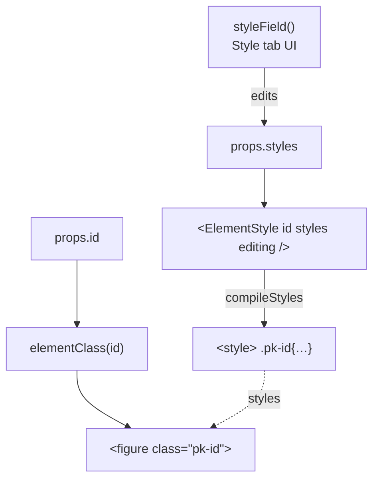

Any Puck component can plug into the kit’s style system. You keep full control of the markup; the kit adds the
style panel, the CSS compilation and the class names.

| Helper | From | Purpose |
| --- | --- | --- |
| `styleField(options?)` | `puck-kit` | The responsive style panel, as a Puck custom field |
| `<ElementStyle id styles editing breakpoints? />` | `puck-kit` | Emits the element’s CSS (server-safe, no hooks) |
| `elementClass(id, advanced?, extra?)` | `puck-kit` | Class names for your root element (`pk-<id>` + extra classes) |
| `advancedField` / `htmlAttrs(advanced, extra?)` | `puck-kit` | Optional: HTML id, extra classes, `aria-label` |
| `tagField(tags)` | `puck-kit` | Optional: a “Tag” select in the Style tab |

## Example: a Figure (image + caption)

```tsx title="lib/Figure.tsx"
import type { ComponentConfig } from '@puckeditor/core';
import {
  advancedField,
  elementClass,
  ElementStyle,
  htmlAttrs,
  styleField,
  type Advanced,
  type KitFields,
  type Styles,
} from 'puck-kit';

export interface FigureProps {
  src: string;
  caption: string;
  styles: Styles;
  advanced: Advanced;
}

export const Figure: ComponentConfig<{ props: FigureProps; fields: KitFields }> = {
  label: 'Figure',
  inline: true, // [!code highlight] no wrapper div: your root element receives puck.dragRef
  fields: {
    src: { type: 'image', label: 'Image' }, // whatever image picker the app plugged in
    caption: { type: 'text', label: 'Caption' },
    styles: styleField(), // [!code highlight]
    advanced: advancedField,
  },
  defaultProps: {
    src: '',
    caption: '',
    styles: { base: { marginLeft: '0', marginRight: '0' } },
    advanced: {},
  },
  render: ({ id, puck, src, caption, styles, advanced }) => (
    <>
      <ElementStyle id={id} styles={styles} editing={puck.isEditing} /> {/* [!code highlight] */}
      <figure ref={puck.dragRef} className={elementClass(id, advanced)} {...htmlAttrs(advanced)}>
        
        {caption && <figcaption>{caption}</figcaption>}
      </figure>
    </>
  ),
};
```

Register it:

```ts title="lib/config.ts"
import { createBuilderConfig } from 'puck-kit';
import { Figure } from './Figure';

export const config = createBuilderConfig({
  components: { Figure },
  categories: { extras: { title: 'Extras', components: ['Figure'] } },
});
```

The `styles` field shows up in the **Style** tab (its `metadata.category` is `"Style"`), your other fields in
**Settings**.

## Rules of thumb

<Steps>
<Step>

### `inline: true` + `ref={puck.dragRef}`

Put the ref on your root element. Without inline mode, Puck wraps your component in a `<div>`, which breaks
the flex/grid layouts of the parent (and the Flex child / Grid child sections).

</Step>
<Step>

### Keep `render` free of hooks

So it works in React Server Components and on public pages without client JavaScript. Put interactive parts
in a separate `"use client"` component rendered inside.

</Step>
<Step>

### Custom breakpoints? Pass them everywhere

`styleField()` and `<ElementStyle>` default to `defaultBreakpoints`. With custom breakpoints, pass the same
array to both:

```tsx
import { breakpoints } from './breakpoints';

fields: { styles: styleField({ breakpoints }) },
render: ({ id, puck, styles }) => <ElementStyle id={id} styles={styles} editing={puck.isEditing} breakpoints={breakpoints} />,
```

</Step>
<Step>

### Containers: render the slot *as* your element

To accept children, use a `slot` field and render it **as** your element, so children are direct DOM children:

```tsx
fields: { content: { type: 'slot' }, styles: styleField() },
render: ({ id, puck, content: Content, styles, advanced }) => (
  <>
    <ElementStyle id={id} styles={styles} editing={puck.isEditing} />
    <Content
      as="figure"
      ref={puck.dragRef}
      className={elementClass(id, advanced, puck.isEditing ? 'pk-slot' : undefined)}
    />
  </>
),
```

`pk-slot` neutralizes Puck’s `width/height: 100%` drop-zone rule in the editor. Or simply use the kit’s factory:
`createContainer({ label: 'Figure', tags: ['figure'], defaultStyles }, { breakpoints })` —
see [Customizing the set](/docs/components/customizing).

</Step>
<Step>

### Limit the panel for simple elements

```ts
styles: styleField({ sections: ['spacing', 'size', 'border'] }),
```

Section ids: `layout`, `flexChild`, `gridChild` (or `child` for both), `spacing`, `size`, `position`,
`typography`, `background`, `border`, `effects`. Pass `states: false` to hide the state bar, or your own list
of states.

</Step>
</Steps>

## How the pieces fit



<Callout type="info" title="Mixing inline styles">
  You can still use inline `style` for things that aren’t user-editable (like the `img` above). Values set in
  the style panel live in a class, so they override nothing you set inline — and vice versa, inline styles win
  over the panel. Keep user-editable properties out of `style`.
</Callout>

<Cards>
  <Card title="Custom blocks with kit fields" href="/docs/guides/custom-blocks" description="Color, font, background, range and checkbox fields in your blocks." />
  <Card title="styleField reference" href="/docs/reference/custom-component-helpers" description="All options and helpers." />
</Cards>
