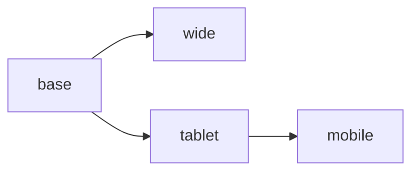
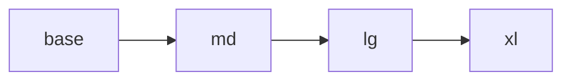

The kit is desktop-first by default, like Webflow: editors design on Desktop and adjust smaller screens.
If your team prefers mobile-first (Tailwind-style), it’s one option:

```ts title="lib/config.ts"
import { createBuilderConfig, mobileFirstBreakpoints } from 'puck-kit';

export const config = createBuilderConfig({ breakpoints: mobileFirstBreakpoints }); // [!code highlight]
```

<Tabs items={['Desktop-first (default)', 'Mobile-first']}>
<Tab value="Desktop-first (default)">

| Key | Label | Media query | Editor viewport |
| --- | --- | --- | --- |
| `wide` | Wide | `(min-width:1280px)` | 1440 |
| `base` | Desktop | — | 1024 |
| `tablet` | Tablet | `(max-width:1023px)` | 768 |
| `mobile` | Mobile | `(max-width:767px)` | 375 |



</Tab>
<Tab value="Mobile-first">

| Key | Label | Media query | Editor viewport |
| --- | --- | --- | --- |
| `base` | Mobile | — | 375 |
| `md` | Tablet | `(min-width:768px)` | 768 |
| `lg` | Desktop | `(min-width:1024px)` | 1024 |
| `xl` | Wide | `(min-width:1280px)` | 1440 |



</Tab>
</Tabs>

## What adapts automatically

- The editor opens on the **base** breakpoint (`usePuckKit` sets the initial viewport) — Mobile here.
- The header switcher and the style panel show your breakpoints.
- Screen-dependent kit defaults are computed from the breakpoints: Container max widths and Columns stacking
  land on the right keys (`md`, `lg`, `xl` instead of `tablet`, `mobile`, `wide`).

## Your own components

Pass the same array to `styleField({ breakpoints })`, `<ElementStyle breakpoints>`, the factories
(`createContainer(opts, { breakpoints })`) and `getPageCss(data, breakpoints)`. Export it from one module:

```ts title="lib/breakpoints.ts"
export { mobileFirstBreakpoints as breakpoints } from 'puck-kit';
```

<Callout type="warn" title="Changing the setup of existing pages">
  Style keys are breakpoint keys. Pages created with the desktop-first keys (`tablet`, `mobile`, `wide`) won’t
  map to `md`/`lg`/`xl`, and `base` changes meaning (Desktop → Mobile). Decide early, or migrate the stored
  `styles` objects.
</Callout>
