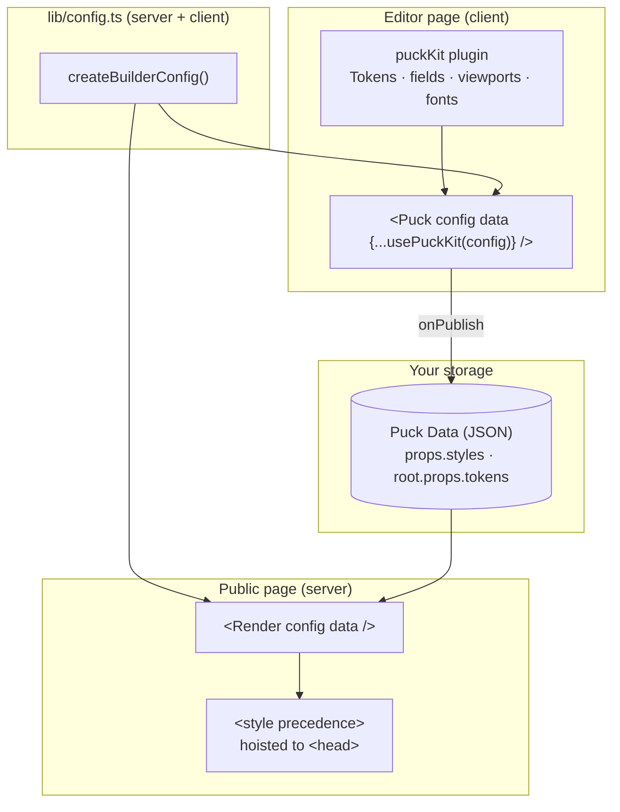
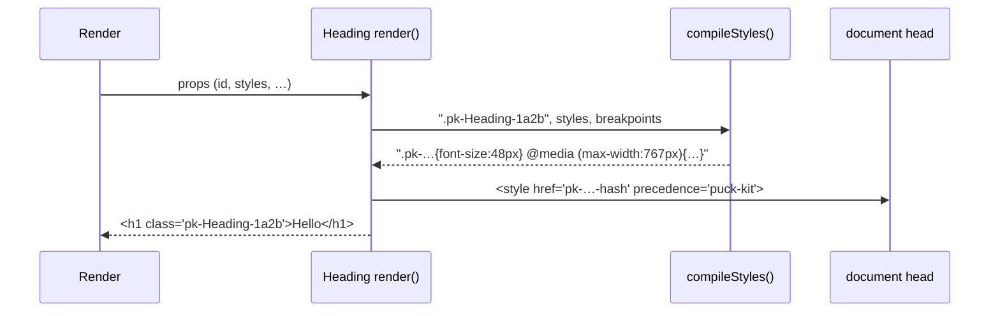

puck-kit doesn't replace Puck. It adds three things on top of it:

1. a **config** (`createBuilderConfig`) holding the native components and a root that emits global CSS;
2. an **editor plugin** (`puckKit` / `usePuckKit`) that adds the style panel, the Tokens panel, field
   types, a breakpoint switcher and a font library to Puck's own editor;
3. a **style compiler** that each component calls while rendering, turning its `styles` prop into CSS.



## The data is plain Puck data

Nothing is hidden in a side store. Each element keeps its styles in a `styles` prop, and the page's design
tokens live in `root.props.tokens`:

```jsonc title="page.json"
{
  "root": {
    "props": {
      "title": "Home",
      "tokens": { "colors": [{ "name": "Primary", "value": "#4f46e5" }] },
      "styles": {}
    }
  },
  "content": [
    {
      "type": "Heading",
      "props": {
        "id": "Heading-1a2b",
        "tag": "h1",
        "text": "Hello",
        "styles": {
          "base": { "fontSize": "48px", "color": "var(--pk-color-primary)" }, // [!code highlight]
          "mobile": { "fontSize": "32px" }, // [!code highlight]
          "base:hover": { "opacity": "0.8" } // [!code highlight]
        },
        "advanced": {}
      }
    }
  ]
}
```

- `base`, `tablet`, `mobile`, `wide` are [breakpoint](/docs/styling/breakpoints) keys;
- `base:hover` is a [state](/docs/styling/states) on a breakpoint;
- `var(--pk-color-primary)` references a [token](/docs/styling/tokens).

## Rendering: from `styles` to CSS

Every kit component renders an `<ElementStyle>` next to its element. It compiles the `styles` prop to CSS
scoped to a class derived from the Puck id (`.pk-<id>`), so server and client output always match.



The compiled CSS for the Heading above:

```css
.pk-Heading-1a2b{font-size:48px;color:var(--pk-color-primary)}
.pk-Heading-1a2b:hover{opacity:0.8}
@media (max-width:767px){.pk-Heading-1a2b{font-size:32px}}
```

On public pages, React 19 **hoists** these `<style>` tags into `<head>`, deduplicates them by `href` and
streams them with SSR. In the editor they are inline inside Puck's iframe, so the viewport switcher drives the
media queries exactly like a real device would. See [CSS output](/docs/styling/css-output) for the details.

## The root

The kit's root component wraps the page in `<div class="pk-page">` and emits, once per page:

- a small `:where()` base stylesheet (box-sizing, margin resets, `.pk-rich` text spacing);
- the tokens as CSS variables (`:root{--pk-color-primary:#4f46e5;…}`);
- the page's own `styles` (the root has a style panel too, without states);
- the `<link>`s for the fonts the page uses.

## Entry points

The package has three entry points, split so that **server code never imports client hooks**:

| Import | Contains | Where |
| --- | --- | --- |
| `puck-kit` | `createBuilderConfig`, breakpoints, factories, styles, tokens, fonts, field definitions | Anywhere (server-safe) |
| `puck-kit/editor` | `puckKit`, `usePuckKit`, `defineFieldType`, panels, `"use client"` | Editor only |
| `puck-kit/styles` | The style toolkit: `styleField`, `ElementStyle`, `compileStyles`, `getPageCss`, … | Anywhere (also re-exported by `puck-kit`) |

```ts twoslash
// @noErrors
import { createBuilderConfig, defaultBreakpoints } from 'puck-kit';
import { getPageCss } from 'puck-kit/styles';

const config = createBuilderConfig({ breakpoints: defaultBreakpoints });
//    ^?
```

<Callout type="info" title="Why plugin + config?">
  The config is used on both sides (editor and public pages), so it can't contain editor UI. Everything that
  only matters while editing lives in the plugin, which you only load on the editor page.
</Callout>
