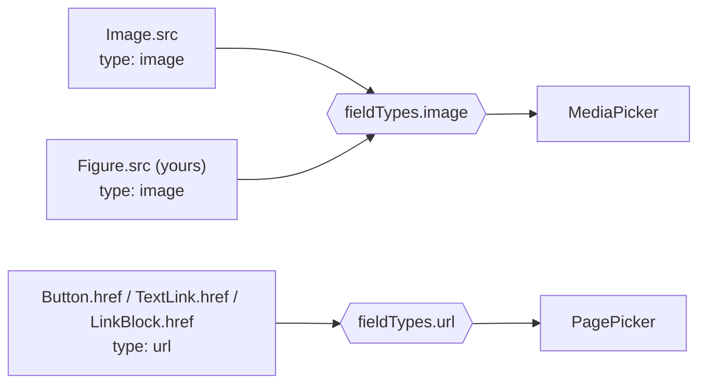

Field renderers are plain Puck `overrides.fieldTypes`. Yours take precedence over the kit’s, and apply to **every
field of that type**, kit components included.

```tsx
import { defineFieldType, type ImageField, type UrlField } from 'puck-kit/editor';

const MediaPicker = defineFieldType<ImageField, string>(({ value, onChange, Label, label, field }) => (
  <Label label={label || field.label || 'Image'}>
    <MyMediaLibrary selected={value} onSelect={(asset) => onChange(asset.url)} />
  </Label>
));

const PagePicker = defineFieldType<UrlField, string>(({ value, onChange, Label, label, field }) => (
  <Label label={label || field.label || 'Link'}>
    <MyPageSelect value={value} onChange={onChange} />
  </Label>
));

<Puck config={config} {...kit} overrides={{ fieldTypes: { image: MediaPicker, url: PagePicker } }} />;
```



## `defineFieldType`

Puck’s types for `overrides.fieldTypes` omit some props it passes (like `Label`). `defineFieldType<F, V>()`
types them and returns a value you can put in `overrides.fieldTypes`.

<auto-type-table path="../../../../../packages/puck-kit/src/fieldTypes/renderers.tsx" name="FieldTypeProps" />

## From a plugin

Ship your pickers as a plugin to reuse them across editors:

```tsx
import type { Plugin } from '@puckeditor/core';

export const mediaPlugin: Plugin = {
  name: 'media',
  overrides: { fieldTypes: { image: MediaPicker } },
};

<Puck {...kit} plugins={[...kit.plugins, mediaPlugin]} />;
```

<Callout type="info" title="Values stay strings">
  Whatever your UI looks like, store a string (`onChange(asset.url)`): components render it directly and pages
  stay portable. Store asset ids elsewhere if you need them (e.g. a `?id=` in the URL, or a separate field).
</Callout>

→ Full walkthrough: [Plug in your media library](/docs/guides/media-library)
