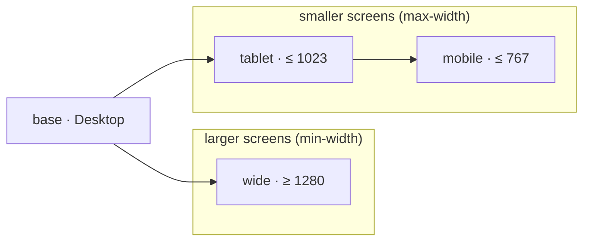

A breakpoint is one of three kinds:

- the **base** — no `minWidth`/`maxWidth`, applies everywhere (exactly one);
- a **smaller screen** — `maxWidth`, inherits from the base and the larger smaller-screens;
- a **larger screen** — `minWidth`, inherits from the base and the smaller larger-screens.

Desktop-first is a base plus `maxWidth` breakpoints, mobile-first a base plus `minWidth` ones, and both can be
mixed — the default set does exactly that (Webflow-style).

<auto-type-table path="../../../../../packages/puck-kit/src/breakpoints.ts" name="Breakpoint" />

## The defaults

```ts
export const defaultBreakpoints: Breakpoint[] = [
  { key: 'wide', label: 'Wide', minWidth: 1280, viewport: 1440, icon: 'Monitor' },
  { key: 'base', label: 'Desktop', viewport: 1024, icon: 'Laptop' },
  { key: 'tablet', label: 'Tablet', maxWidth: 1023, viewport: 768, icon: 'Tablet' },
  { key: 'mobile', label: 'Mobile', maxWidth: 767, viewport: 375, icon: 'Smartphone' },
];
```



The editor **opens on Desktop** (the base), and the breakpoint switcher in the header shows all four:

<Screenshot src="editor-viewport-bar.png" alt="The breakpoint switcher in the editor header" caption="The header switcher — the bar under the icons shows which breakpoints the active one also styles." variant="panel" maxWidth={420} />

## Mobile-first

```ts
import { createBuilderConfig, mobileFirstBreakpoints } from 'puck-kit';

createBuilderConfig({ breakpoints: mobileFirstBreakpoints });
// base = Mobile (375), md ≥ 768, lg ≥ 1024, xl ≥ 1280
```

See the [mobile-first guide](/docs/guides/mobile-first) for the implications.

## Custom breakpoints

```ts title="lib/breakpoints.ts"
import type { Breakpoint } from 'puck-kit';

export const breakpoints: Breakpoint[] = [
  { key: 'xl', label: 'Large', minWidth: 1536, viewport: 1600, icon: 'Monitor' },
  { key: 'base', label: 'Desktop', viewport: 1280, icon: 'Laptop' },
  { key: 'md', label: 'Tablet', maxWidth: 991, viewport: 820, icon: 'Tablet' },
  { key: 'sm', label: 'Phone', maxWidth: 575, viewport: 390, icon: 'Smartphone' },
];
```

```ts title="lib/config.ts"
import { createBuilderConfig } from 'puck-kit';
import { breakpoints } from './breakpoints';

export const config = createBuilderConfig({ breakpoints });
```

`createBuilderConfig` validates them and throws if:

<Steps>
<Step>

### There isn’t exactly one base

`puck-kit: exactly one breakpoint must be the base (no minWidth / maxWidth).`

</Step>
<Step>

### Ranges overlap

`puck-kit: every maxWidth breakpoint must be below every minWidth breakpoint.`

</Step>
<Step>

### Keys repeat

`puck-kit: breakpoint keys must be unique.`

</Step>
</Steps>

<Callout type="warn" title="Use them everywhere">
  The config, `usePuckKit` and the kit’s components pick them up automatically. Your own components, the
  factories and `getPageCss` need them passed explicitly (they default to `defaultBreakpoints`).
</Callout>

## Viewports

Each breakpoint has a `viewport` — the canvas width the editor uses when you select it. `usePuckKit` turns them
into Puck `viewports` (`toViewports(breakpoints)`) and opens on the base. Puck only knows three icons, so
`Laptop` is shown as `Monitor` in Puck’s own controls; the kit’s switcher shows all four.

## Helpers

| Function | Returns |
| --- | --- |
| `baseBreakpoint(bps)` | The base breakpoint |
| `cascadeOf(bps, key)` | Breakpoints `key` inherits from, base first and itself last |
| `mediaQuery(bp)` | `(min-width:…px)`, `(max-width:…px)` or `null` for the base |
| `breakpointForWidth(bps, width)` | The breakpoint active at a viewport width |
| `toViewports(bps)` | Puck `viewports`, widest first |
| `getBreakpoints(config)` | The breakpoints a config was created with |

→ [Breakpoints reference](/docs/reference/breakpoints)
