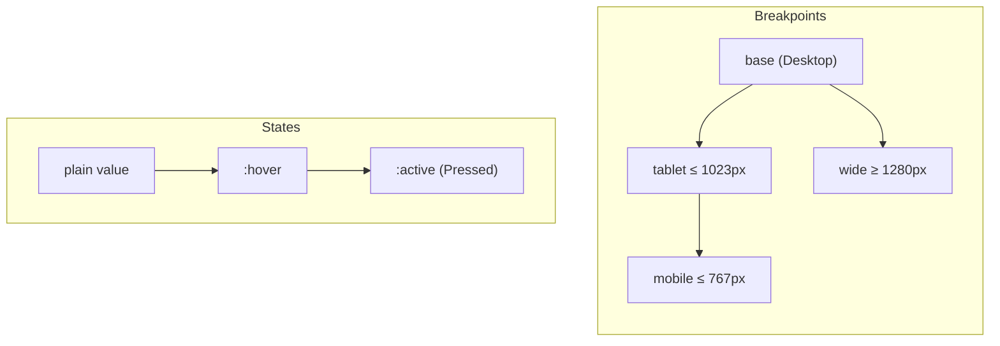

Every kit element — and any component using [`styleField()`](/docs/guides/custom-components) — has a
`styles` prop. The style panel edits it; the compiler turns it into CSS. Nothing else is involved: no runtime,
no class generation at build time, no global stylesheet to maintain.

<Screenshot src="style-panel.png" alt="The style panel for a Button: tag, breakpoint bar, state bar and sections" caption="The Style tab of a Button." variant="panel" maxWidth={400} />

## The shape of `styles`

```ts twoslash
// @noErrors
import type { Styles } from 'puck-kit';

const styles: Styles = {
  base: { fontSize: '48px', color: 'var(--pk-color-primary)' },
  tablet: { fontSize: '36px' },
  mobile: { fontSize: '28px' },
  'base:hover': { opacity: '0.8' },
};
```

<TypeTable
  type={{
    '<breakpoint>': { type: 'StyleDecl', description: 'Declarations applied from this breakpoint (e.g. `base`, `tablet`, `mobile`, `wide`).' },
    '<breakpoint>:<state>': { type: 'StyleDecl', description: 'Declarations for a state on a breakpoint (e.g. `base:hover`, `tablet:active`).' },
  }}
/>

A `StyleDecl` maps camelCase CSS properties (from a whitelist of about 100, `STYLE_PROPS`) to strings:

- **Numbers get `px`**: `"16"` → `16px`, except unitless properties (`flexGrow`, `flexShrink`, `order`,
  `zIndex`, `fontWeight`, `lineHeight`, `opacity`, `aspectRatio`). `"0"` stays `0`.
- **Tokens** are CSS variables: `var(--pk-color-primary)`, `var(--pk-size-md)`.
- **Sanitized**: `;`, `{`, `}`, `<` and `>` are removed, so a value can’t break out of its declaration or of the
  `<style>` tag.
- **Ordered**: declarations are emitted in a fixed property order (shorthands before longhands), not in
  insertion order.

## The cascade



1. **Breakpoints inherit.** A value set on `base` applies everywhere; `tablet` overrides it ≤ 1023px; `mobile`
   inherits from `tablet` and overrides it ≤ 767px. The panel shows inherited values in **orange** and
   values set on the current breakpoint in **blue**.
2. **States win over plain values.** `base:hover` keeps applying on Tablet and Mobile (state rules are more
   specific) unless you set a hover value there.
3. **Later states win at equal specificity.** States are emitted in link-visited-hover-focus-active order, so
   *Pressed* overrides *Hover*.

<Screenshot src="style-inherited.png" alt="Typography section on Tablet with inherited values in orange" caption="On Tablet, the Desktop font size and weight are inherited (orange)." variant="panel" maxWidth={420} />

## From data to CSS

```css
/* styles of the Heading above, element id "Heading-1" */
.pk-Heading-1{font-size:48px;color:var(--pk-color-primary)}
.pk-Heading-1:hover{opacity:0.8}
@media (max-width:1023px){.pk-Heading-1{font-size:36px}}
@media (max-width:767px){.pk-Heading-1{font-size:28px}}
```

Rules are emitted base first, then larger screens (`min-width`, ascending), then smaller screens
(`max-width`, descending) — so each breakpoint overrides the ones it inherits from.

<Cards>
  <Card title="Breakpoints" href="/docs/styling/breakpoints" description="Defaults, mobile-first and custom setups." />
  <Card title="States" href="/docs/styling/states" description="Hover, pressed, focus and structural states." />
  <Card title="Design tokens" href="/docs/styling/tokens" description="Colors, fonts and sizes as CSS variables." />
  <Card title="Fonts" href="/docs/styling/fonts" description="A font library, loaded only where used." />
  <Card title="The style panel" href="/docs/styling/style-panel" description="Every section, control and shortcut." />
  <Card title="CSS output" href="/docs/styling/css-output" description="Hoisting, the base stylesheet, getPageCss." />
</Cards>
